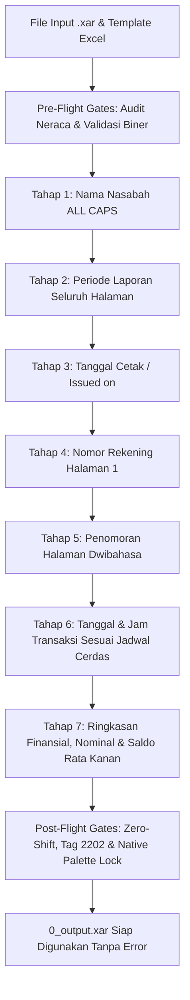

# Xara Co-Pilot V2 Engine

[](https://www.python.org/downloads/)
[](https://www.xara.com/)
[]()
[]()

Asisten otomasi presisi tinggi generasi kedua (**Project V2**) untuk pemrosesan, standarisasi, dan modifikasi dokumen biner **Xara Designer Pro+ (`.xar`)**, khususnya dokumen *e-Statement* / rekening koran perbankan (Bank Mandiri).

Sistem ini memanipulasi file biner `.xar` secara langsung pada tingkat DOM biner (Stream 5 DEFLATE, Tag Matrices, Kerning, Palet Warna, dan Unicode records) sehingga font native tetap konsisten visualnya meskipun font tersebut tidak terinstall di sistem operasi Windows.

---

## 🌟 Fitur Utama & Inovasi Arsitektur V2

### 1. 🌐 Universal Adaptive Spatial Engine
* **Zero Hardcoded Indices**: Sistem tidak bergantung pada nomor record statis. Seluruh elemen dideteksi secara spasial menggunakan pemetaan koordinat 2D ($x, y$ dalam milipoin) dan hierarki pohon DOM Xara.
* **Skalabilitas Multi-Halaman**: Mampu memproses dokumen dengan jumlah halaman berapa pun (2, 3, 5, 7, hingga 10+ halaman) dan densitas tabel mutasi bervariasi secara otomatis tanpa konfigurasi ulang.

### 2. 🎨 Native Palette Harvester (Tag 51 & Tag 150)
* **Pencegahan Modal Peringatan Warna**: Secara otomatis memanen (*harvest*) palet warna native dari record Tag 51 dokumen asli (Hijau Kredit, Hitam Debit, Biru Saldo, Abu-abu Saldo Awal).
* **Safe Fallback**: Setiap ID warna yang tidak terdaftar dalam dokumen dikembalikan ke warna hitam native dokumen terkait, mencegah munculnya kotak dialog *Foreign Palette Warning* saat file dibuka di Xara Designer Pro+.

### 3. 🧩 Atomic Glyph & Text Slot Distribution (Tag 2202 & Tag 2201)
* **Anti-Truncation Engine**: Mendistribusikan karakter secara proporsional ke rantai node Tag 2202 (single-character glyph) dan Tag 2201 (multi-character string).
* **Zero-Byte Safety Gate**: Mencegah dan menyembuhkan node teks berukuran 0 byte yang dapat menyebabkan *streaming read error* atau *crash* pada aplikasi Xara.

### 4. 📄 Bilingual Header & Page Numbering Preservation
* **Penomoran Dwibahasa Resmi**: Mempertahankan format penomoran bahasa Indonesia reguler (`1 dari 5` pada $y=736.000$) dan bahasa Inggris miring (`1 of 5` Italic pada $y=726.000$) secara bersih tanpa sisa digit kembar (*ghost digits*).

### 5. 🛡️ Merged Story & Multi-Line Collision Guard
* **Multi-Line Stories**: Mendukung pembacaan dan penyuntingan story tanggal dan jam yang menyatu menggunakan *newline* internal (Tag 2200).
* **3-Case Row Numbering**: Mendukung pembaruan nomor urut baris mutasi baik pada:
  1. *Isolated Number Story* (standar).
  2. *Pure Merged Story* (nomor urut menyatu dengan uraian transaksi, e.g. Row 37).
  3. *Split-Digit Merged Story* (digit puluhan terpisah dari digit satuan yang menempel pada uraian, e.g. Row 26 & 34), dengan perlindungan 100% pada teks uraian transaksi.

### 6. 📊 Spreadsheet Parser dengan Auto-Healing & Audit Neraca
* **Pre-Flight Gate 1 (Audit Neraca)**: Memvalidasi rumus akuntansi sebelum modifikasi file dilakukan:
  $$\text{Saldo Awal} + \text{Dana Masuk (Kredit)} - \text{Dana Keluar (Debit)} = \text{Saldo Akhir}$$
* **Auto-Healing Inkonsistensi Periode**: Menyinkronkan teks periode header jika terjadi ketidaksesuaian akibat *copy-paste* pada spreadsheet input.
* **Adaptive Calendar Clamping**: Menyesuaikan hari kalender secara otomatis dengan batas bulan kalender resmi (misalnya 30 September, 28/29 Februari).

### 7. 🔒 Zero-Shift Record Count Invariant
* Menjamin jumlah record biner sebelum dan sesudah eksekusi tetap identik:
  $$\text{Total Records}_{\text{Initial}} \equiv \text{Total Records}_{\text{Final}}$$
* Sinkronisasi otomatis ukuran payload record (`size == len(payload)`).

---

## 📁 Struktur Direktori Repositori

```text
xara_copilot_V2/
├── jalankan_pipeline.bat        # Launcher batch Windows (otomatis / drag-and-drop Excel)
├── run_copilot_admin.bat        # Launcher mode Administrator
├── run_project_v2_pipeline.py   # Master Pipeline Runner (Tahap 1 - 7 otomatis & adaptif)
├── xar_dom_engine.py            # Core Binary Parser & DOM Manipulation Engine
├── xara_bridge_service.py       # Win32 GUI Automation Bridge ke Xara Designer Pro+
├── smart_date_time_generator.py # Generator Tanggal & Jam Transaksi Cerdas
├── parse_excel_template.py      # Parser template spreadsheet masukan dengan auto-healing
├── xar_cli.py                   # Antarmuka Command-Line (CLI) inspeksi & update
├── Template_Pekerjaan_Xara.xlsx # Template Excel resmi input mutasi rekening
│
├── docs/                        # Dokumentasi SOP & Basis Pengetahuan
│   ├── PROJECT_V2_SOP.md        # Master SOP 7 Tahap Pengeditan Dokumen
│   ├── PROSEDUR_TAHAP_7_STANDAR.md # Standar Mutasi, Pewarnaan, & Saldo
│   └── KNOWLEDGE_BASE_XARA_PROCEDURES_AND_ERRORS.md # Solusi 40+ Kasus Error Biner Xara
│
├── data/                        # Dataset & File Pemetaan
│   ├── mappings/                # File JSON pemetaan baris, jadwal, & training history
│   └── dumps/                   # File teks log ekstraksi & dump baris transaksi
│
└── scripts/                     # Koleksi Skrip Pengujian & Utilitas Terstruktur
    ├── inspect/                 # Skrip investigasi node, koordinat, & error analysis
    ├── verify/                  # Skrip audit, verifikasi alignment & palet warna
    ├── tests/                   # Skrip unit test & pengujian engine
    └── archive/                 # Skrip tahapan transisi & eksperimen historis
```

---

## 🚀 Cara Menjalankan

### 1. Menjalankan Pipeline Otomatis (Rekomendasi)
Cukup lakukan **drag-and-drop** file `Template_Pekerjaan_Xara.xlsx` (atau folder kerja yang berisi file `.xar` dan file `.xlsx`) ke file:
```cmd
jalankan_pipeline.bat
```

Atau jalankan melalui command prompt / PowerShell:
```bash
# Menjalankan pada folder kerja
python run_project_v2_pipeline.py "D:\path\ke\folder_kerja" --fast

# Menjalankan spesifik file template Excel
python run_project_v2_pipeline.py --excel "D:\path\ke\Template_Pekerjaan_Xara.xlsx" --fast

# Uji kelayakan awal tanpa memodifikasi file (Dry Run)
python run_project_v2_pipeline.py "D:\path\ke\folder_kerja" --dry-run
```

### 2. Menggunakan CLI Cepat (`xar_cli.py`)
Melihat daftar transaksi dalam file `.xar`:
```bash
python xar_cli.py --file "dokumen.xar" --list
```

Mengubah baris transaksi tertentu:
```bash
python xar_cli.py --file "dokumen.xar" --row 1 --time "08:15:00 WIB" --nominal "+5.000.000,00"
```

Mengubah nama nasabah:
```bash
python xar_cli.py --file "dokumen.xar" --name "NAMA NASABAH"
```

---

## 📜 Alur Standar 7 Tahap (Master SOP)

Proses pengeditan dokumen dijalankan secara berurutan (*sequential*) untuk menjamin integritas biner:



1. **Tahap 1 - Perubahan Nama**: Pengubahan nama pemilik rekening (`Nama/Name`) pada seluruh halaman dengan format *ALL CAPS* dan line break cabang.
2. **Tahap 2 - Perubahan Periode**: Pengubahan rentang tanggal laporan header pada seluruh halaman secara serentak (`01 Mon YYYY - DD Mon YYYY`).
3. **Tahap 3 - Perubahan Dicetak Pada**: Sinkronisasi tanggal penerbitan dokumen (*Issued on*) di seluruh lembar halaman.
4. **Tahap 4 - Perubahan Nomor Rekening**: Pengubahan nomor rekening nasabah pada Header Halaman 1.
5. **Tahap 5 - Perubahan Nomor Halaman**: Sinkronisasi nomor halaman dwibahasa (`X dari Y` dan `X of Y` Italic).
6. **Tahap 6 - Penyesuaian Tanggal & Jam**: Pengurutan kronologis, batas jam kerja bank (06:00 - 22:55 WIB), dan penguncian transaksi berjangkar manual.
7. **Tahap 7 - Perubahan Finansial & Mutasi**: Pengubahan Saldo Awal, Dana Masuk (Hijau Native), Dana Keluar (Hitam Native), Saldo Akhir (Biru Native), dan perataan kanan (*ruler locking*) presisi per milipoin.

Detail lengkap prosedur dapat dilihat di [docs/PROJECT_V2_SOP.md](docs/PROJECT_V2_SOP.md).

---

## 🛠️ Persyaratan Lingkungan (System Requirements)

* **Sistem Operasi**: Windows 10 / Windows 11 (64-bit).
* **Python**: Python 3.10 atau lebih baru.
* **Dependensi Python**:
  ```bash
  pip install openpyxl
  ```
  *(Modul `openpyxl` digunakan untuk membaca dan menulis template spreadsheet Excel).*
* **Aplikasi Desain**: Xara Designer Pro+ (opsional untuk *viewing* / ekspor PDF manual).
* **Koneksi Internet**: **Tidak diperlukan** (100% *Offline* & *Token-Free*).

---

## 📄 Lisensi & Hak Cipta
Hak Cipta © 2026 Xara Co-Pilot V2 Architecture. Dikelola untuk pemrosesan presisi dokumen biner e-Statement.